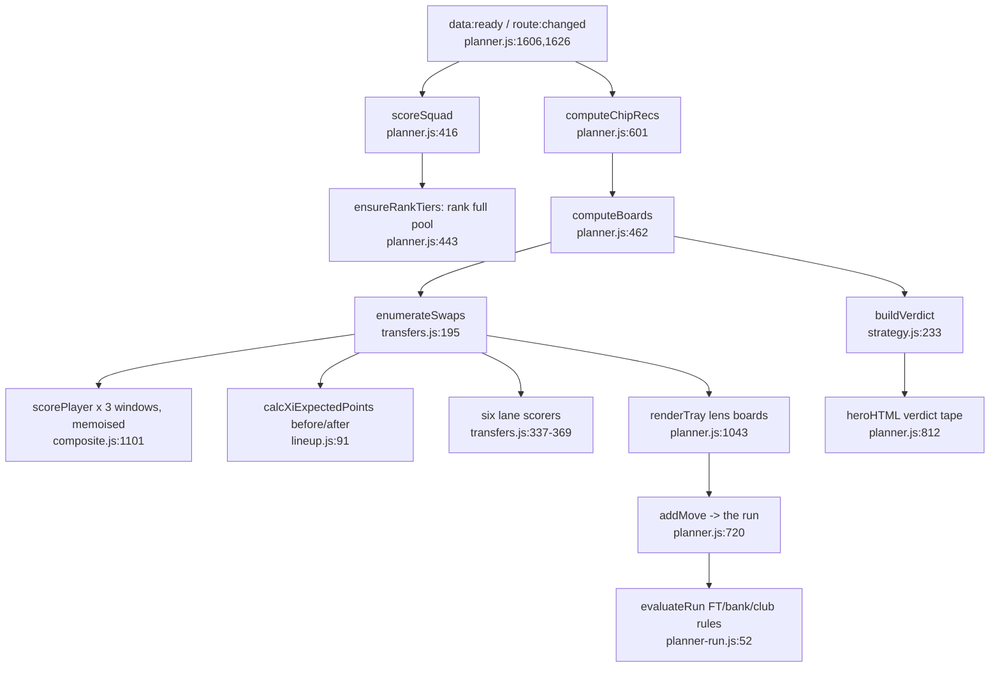

# Decision engine plan (Phase 0)

Date: 2026-10-16
Status: **draft, awaiting approval** - no code has been changed.
Brief: `fpl-decision-engine-brief.md` (16 Oct 2026). Section numbers below
(§3, §5 ...) refer to the brief unless prefixed with a file name.
Scope: `projects/apps/gaffer-iq/` only. Branch:
`Refactor/gaffer-IQ-transfer-suggestion-engine-redesign`.

## Primary goal

When you open the Transfer Planner, each of the six modes shows one move (or
"Roll"), scored by what it does to your whole squad over that mode's horizon,
with the reasons behind it laid out so you can check it before you act. A bench
filler is never offered as a sell just because his own numbers are low, and a
captain is never sold without the loss of the armband being counted.

---

## 1. Inventory: where the current transfer feature lives

### 1.1 Engine (pure JS, no DOM)

| File | Symbol | Role |
|---|---|---|
| `js/engine/transfers.js:195` | `enumerateSwaps` | Enumerates every single swap from a 40-per-position candidate pool and scores it on six lanes. |
| `js/engine/transfers.js:49` | `memoScore` | Per-window `scorePlayer` cache (three windows: `long`, `now1`, `far`). |
| `js/engine/transfers.js:91,128` | `candidateProxyScore`, `buildCandidatePools` | Season points per elapsed GW, top `CANDIDATE_POOL_PER_POS` (40) per position. |
| `js/engine/transfers.js:434` | `calcSquadFlexibility` | Price-clumping / headroom index (feeds the `cashCrunch` trigger). |
| `js/engine/transfers.js:491,552,610,693` | `scoreFutureLane`, `scoreFundsLane`, `scoreCeilingLane`, `scoreStructureLane` | Four of the six lanes. Now and Long term are inline at `:337-353`. |
| `js/engine/strategy.js:233` | `buildVerdict` | Normalises lanes by hand-calibrated `LANE_SCALE_*` divisors, ranks them, applies triggers, emits one weekly verdict or "roll". |
| `js/engine/strategy.js:93` | `detectTriggers` | `xiPlayerUnavailable`, `chipWindow`, `cashCrunch`, `priceDeadline`. |
| `js/engine/lineup.js:44` | `pickStartingXI` | Greedy XI + bench order by `expectedPoints`. **Shared with the Dashboard** (`js/modules/dashboard.js:515`). |
| `js/engine/lineup.js:91` | `calcXiExpectedPoints` | XI sum + `BENCH_CONTRIBUTION_WEIGHT` (0.15) x bench. The quantity every lane differences. |
| `js/engine/prices.js:36` | `calcPriceChangeRisk` | Price-move guess from in-GW transfer flow. Used by the Funds lane and the planner's "Buy now" note. |
| `js/engine/chips.js:125-321` | `score*Timing` | Chip week recommendations; feed the `chipWindow` trigger and the run's chip pills. |

### 1.2 Module / UI

| File | What |
|---|---|
| `js/modules/planner.js` (1,686 lines) | The whole Transfer Planner view. Verdict "tape" (Out -> In) `heroHTML:812`; run settings bar `renderCmd:925`; "the run" (six staged weeks of moves and chips) `renderRun:984`, `weekHTML:946`; move tray with lens radio `renderTray:1043`; squad drawer `renderDrawer:1177`; import `handleImport:1506`; enumeration driver `computeBoards:462`; chip recs `computeChipRecs:601`. |
| `js/modules/planner-boards.js` | `LANE_BOARDS` (six boards, titles, blurbs, units), `LANE_DIRECTIONS`, `timingNote`, `emptyMessage`. |
| `js/modules/planner-run.js` | `evaluateRun`: FT rolling (cap 5), hits, bank carry, 3-per-club, one chip per week. Pure, module layer. |
| `index.html:437-535` | Planner markup: hero, settings bar (bank, FT 1/2, hits, squad), run, tray, drawer, toast, dialog. |
| `css/planner.css` (334 lines) | Every rule nested under `.pl`; tokens from `css/base.css`. |
| `js/main.js:30-32, 524-527` | `window.__verify` exposes `enumerateSwaps`, `buildVerdict`, `calcXiExpectedPoints`, `calcSquadFlexibility`. |

### 1.3 Data, routes, persistence

There are **no database tables** anywhere (see §3). The feature's state is:

- Route: hash route `#planner` (`js/main.js` router).
- Proxy routes used: `entry/{id}/event/{gw}/picks/`, `entry/{id}/` (`api/fpl.js:34-35`). `me/` is allowlisted (`:36`) but useless: the proxy forwards no credentials, and must not.
- `sessionStorage`: squad ids and imported picks (`js/store.js:400-441`).
- `localStorage`: `gafferiq_planner_run` (staged run), `gafferiq_chips_used`, `gafferiq_fpl_team_id`.

### 1.4 Config and tests

- `js/config.js:1294-1461`: `XI_FORMATION_MIN`, `HIT_PENALTY`, `BENCH_CONTRIBUTION_WEIGHT`, window constants, `CANDIDATE_POOL_PER_POS`, `FUNDS_MIN_CASH_FREED`, `FLEX_*`, `CEILING_*`, `HAUL_POINTS_THRESHOLD`, `STRUCTURE_PLAYTIME_FLOOR`, `LANE_SCALE_*`, `VERDICT_*`.
- Tests: `tests/engine/transfers.test.js`, `strategy.test.js`, `lineup.test.js`, `tests/modules/planner-run.test.js`.
- Docs: `FEATURE_ENGINE.md` §14 (lines 1215-1354); specs `docs/superpowers/specs/2026-08-30-planner-multi-lens-transfers-design.md` and `2026-09-07-planner-horizon-split-and-value-funds-design.md`; `GAFFER_IQ_TESTING_ROADMAP.md:267-431`.

### 1.5 The six existing modes

They already exist as the six boards (`planner-boards.js:35`), so the brief's
six presets map one to one:

| Brief mode | Current board id | Current window and ranking |
|---|---|---|
| 1 Now | `now` | 1 GW, XI delta |
| 2 Long term | `longterm` | 5 GWs, XI delta x 5 |
| 3 Future prep | `future` | GWs 3-5, XI delta x 3 |
| 4 Funds & flexibility | `funds` | 5 GWs, points gained per GBP m freed |
| 5 Ceiling | `ceiling` | incoming player's own peak week + haul rate |
| 6 Structure fix | `structure` | flagged / low playtime / bottom-percentile starter, XI delta x 5 |

### 1.6 Current flow



### 1.7 Defects in the current engine against the brief

Each one is a reason for the gut, with evidence:

1. **Budget uses current price, never sell price.** `transfers.js:273-274` (`priceDiff > budget`). Brief §10 pitfall 3.
2. **No 3-per-club check during enumeration.** Only checked once a move is staged into the run (`planner-run.js:79-90`), so the boards can recommend an illegal move.
3. **Squad value has no captain term.** `lineup.js:91-106` sums the XI and bench; selling the only strong captain option costs no more than his raw points. Pitfall 5.
4. **Bench = flat 0.15 weight**, not autosub probability, no formation legality.
5. **Next-GW availability carried flat across every window.** `calcPlayingLikelihood` (`form.js:490`) reads `chanceOfPlayingNext` whatever window is being scored, so the GW 3-5 window inherits this week's 25%. Pitfall 4, named in §3.
6. **One projection per window, not per GW.** `expectedPoints` takes the fixture count from the window's first GW only (`composite.js:1204-1207`), averages the fixture multiplier across the window, and the lanes multiply that per-GW rate by the window length (`transfers.js:310-311`). Blanks and doubles inside a window are miscounted (acknowledged and deferred in spec 2026-09-07 §6).
7. **Blank GW keeps 10% of a projection.** `calcExpectedPoints` count term is `1 + 0.9 x (0 - 1) = 0.1` at zero fixtures (`composite.js:1068`). The existing test `tests/engine/composite.test.js:98` asserts 0 and fails today.
8. **Transfer economics are thin.** A single swap's cost is 0 whenever FT >= 1 (`transfers.js:263`); the UI only allows 1 or 2 FTs (`index.html:459-462`); there is no FT value, so "roll" is decided by a lane clearing an arbitrary normalised threshold (35), not by beating the value of a banked transfer. Pitfall 6.
9. **Lanes are compared by convention, not units.** `LANE_SCALE_*` divisors were hand-fitted to one live sample (`FEATURE_ENGINE.md` §14.4 says so).
10. **Structure Fix and Ceiling score the player, not the squad.** Structure fires on rank tier (`transfers.js:710-711`); Ceiling ranks the incoming player's own peak (`:610-658`). Pitfall 1.

---

## 2. Prediction layer audit (§3 data contract)

The prediction engine is `scorePlayer` (`js/engine/composite.js:1101`). It
returns, per player and per **window**, a 0-100 composite `value` and a real
points figure `expectedPoints` (`calcExpectedPoints`, `composite.js:1061`):

```
expectedPoints = avgPointsPerGw x fixtureMultiplier x (min(startShare, availability) / 100) x countMultiplier
```

A per-GW series can already be produced without changing the model: call
`scorePlayer` with `{ gws: 1 }` and `ctx.currentGw` shifted by k for k = 0..5.
This is the pattern `transfers.js:216` already uses for its far window.

| Field | Status | Where / how | What v1 does |
|---|---|---|---|
| `xpts` | **Approximation** | `score.expectedPoints.value`. Includes minutes (`min(startShare, availability)`), so it must not be multiplied by a start probability again. Per window, not per GW; blank-GW residue (defect 7). | Six single-GW calls per player. Fix the blank residue at its root in `calcExpectedPoints`. Availability for k >= 1 comes from the recovery curve (below), passed in as a cloned player with an adjusted `chanceOfPlayingNext`, so `scorePlayer` itself is untouched. |
| `p_start` | **Approximation** | `breakdown.minutes.startShare` = season minutes-security (`form.js:491`); also `breakdown.playtime.startRate` (`form.js:573`, shrunk to a price prior). Neither is per GW. | `pStart_t = availability_t x startRate`. Flagged approximate until Phase 4. |
| `p_zero` | **Not produced** | Nearest input: `availability` = FPL `chance_of_playing_next_round`, else `STATUS_PLAY_CHANCE[status]` (`form.js:495-498`). | GW+1: `1 - availability x appearRate`. Later GWs: recovery curve (config) moves availability toward 1 by status (injured, doubtful, suspended), never carried flat. Blank GW: 1. Double GW: misses both. `appearRate` comes from loaded `history[]` when present, else `startRate`. |
| `p_60` | **Not produced** | `calcPlaytimeSecurity` has `completion` = minutes / (starts x 90). | `p60_t = pStart_t x completion`, with `p60Approx: true`. |
| `xpts_if_plays` | **Not produced** | Can be backed out of `xpts`. | `xptsIfPlays_t = xpts_t / max(eps, 1 - pZero_t)`; 0 on a blank. This keeps `xpts = (1 - pZero) x xptsIfPlays` true by construction. |
| `p_p90` | **Not produced** | Ceiling lane's haul rate (`transfers.js:639-642`) is a backward-looking proxy only. | `null` until Phase 7. |
| Point-in-time snapshots | **Not produced** | `js/calibration.js` stores per-GW *fixture* composite snapshots in the browser's `localStorage`. No player data, no flags, nothing server-side. | Phase 1 snapshot job. |

---

## 3. Stack facts

- **Language and runtime.** Vanilla JavaScript ES modules, served as authored: no framework, no bundler, no transpiler (`ARCHITECTURE.md` §1, §4). `package.json` has **zero dependencies**. Tests run on Node's built-in runner (`npm test` -> `node --test tests/**/*.test.js`). Baseline today: **219 tests, 213 pass, 6 fail** (5 in `channel.test.js`, 1 in `composite.test.js` - the blank-GW case above).
- **Data store.** None on the server. `api/fpl.js` is a stateless Vercel function: an allowlisted, cached CORS proxy that "must not store data. No database, no KV" (`ARCHITECTURE.md` §5). Client state is `js/store.js` (memory + `sessionStorage`) plus a few `localStorage` keys.
- **How predictions are produced and refreshed.** In the browser, on demand. Boot fetches `bootstrap-static/` and `fixtures/`, then prefetches Understat team xG for all 20 clubs; modules wait for `store.isTeamXgSettled()` and then call `buildScoreContext` + `scorePlayer`. Refresh = page load (proxy caches bootstrap for 300 s). Player summaries load lazily, never in bulk.
- **How the squad is stored.** `store.getSquad()`: an array of 15 player ids. Imported picks (slot 1-15, captain, vice) are kept separately (`store.js:400-441`) and are only used to show "your XI vs the model's XI". Starters and bench are always re-picked by `pickStartingXI`.
- **Purchase prices.** **Not stored anywhere.** Bank is a manual input (`#pl-bank`) although the picks payload already carries `entry_history.bank`. Free transfers are a manual 1 or 2 toggle.
- **Ledger sources available.** The public `entry/{id}/transfers/` (each buy with `element_in_cost` and GW) and `entry/{id}/history/` (per-GW transfers and chips) are not allowlisted yet. The authenticated my-team endpoint cannot be used (the proxy has no credentials and must not get them). So the ledger is built from `transfers/`, with players held since the start priced from `element-summary` `history[].value` for the GW they arrived.

---

## 4. Gut plan

### 4.1 Deleted (in the UI phase, once the new screen is live)

- `js/engine/transfers.js` (whole file) and `js/engine/strategy.js` (whole file).
- `js/modules/planner-boards.js` and `js/modules/planner-run.js` (whole files; see question Q4 about the run).
- In `js/modules/planner.js`: the verdict tape, the run, the move tray and lens boards, and their state (`_moves`, `_chipsAt`, `_swaps`, `_verdict`, `RUN_KEY` persistence, FLIP animation code).
- In `index.html`: the run, settings-bar FT 1/2 radio, tray markup. In `css/planner.css`: `.tape`, `.run`, `.wk`, `.tray`, `.lens`, `.cards` rules.
- `calcXiExpectedPoints` from `js/engine/lineup.js`; `calcPriceChangeRisk` and the unused `rankByPriceRise`/`rankByPriceFall` from `js/engine/prices.js` once the Phase 5 price adapter replaces them.
- Config: `BENCH_CONTRIBUTION_WEIGHT`, `NOW_WINDOW_GWS`, `FUTURE_*`, `CANDIDATE_POOL_PER_POS`, `FUNDS_MIN_CASH_FREED`, `FLEX_*`, `CEILING_*`, `HAUL_POINTS_THRESHOLD`, `STRUCTURE_PLAYTIME_FLOOR`, `LANE_SCALE_*`, `VERDICT_*`.
- Tests: `tests/engine/transfers.test.js`, `tests/engine/strategy.test.js`, `tests/modules/planner-run.test.js`, the `calcXiExpectedPoints` cases in `lineup.test.js`.
- `window.__verify` transfer hooks in `js/main.js` (replaced by hooks for the new engine).
- `FEATURE_ENGINE.md` §14 is replaced by a short pointer to `docs/decision-engine.md`. The two superseded specs and the old plan stay in `docs/superpowers/` as history, marked superseded.

### 4.2 Kept

- The whole prediction layer: `composite.js`, `form.js`, `counter.js`, `fixtures.js`, `channel.js`, `normalise.js`, `season.js`, `h2h.js`, `style.js`, `standings.js`. Extended only by the projection adapter and the blank-GW fix.
- `pickStartingXI` (`lineup.js:44`), given an optional value accessor so the squad value function can rank by a GW's `xpts` while the Dashboard keeps calling it exactly as today. Greedy minimum-then-fill is provably optimal for this constraint set; Phase 2 adds a test that it matches brute-force formation enumeration.
- `js/engine/chips.js` and chip-used tracking (they feed the chip plan the Ceiling mode and Bench Boost weeks need).
- Data ingestion: `api.js`, `api/fpl.js`, `store.js`, `squadImport.js` (all extended, not replaced).
- Planner shell: data-ready / settle gating, `route:changed` deferral, squad drawer, import form, toast, confirm dialog, bank input.

### 4.3 How the new UI sits in the site

The new screen replaces the contents of the existing `#planner` module view.
It keeps the app's design system: tokens from `css/base.css` (`--color-*`,
`--band-*`, `--font-*`, `--radius-*`), BEM-lite classes nested under `.pl` in
`css/planner.css`, the score-chip and band vocabulary, skeletons for unsettled
values (`CONVENTIONS.md` §5.4), and entrance motion gated on `[data-anim]` and
`prefers-reduced-motion`. The Dashboard and other tabs are not touched. Layout,
in reading order:

1. Settings bar: bank (from import, editable), FTs 0-5 (derived, editable), chip plan (chip -> GW).
2. Six mode cards (§8 items 1-7).
3. Captain and XI panel.
4. Sell / hold table with lock and ban buttons.

### 4.4 Isolation

All work happens on this branch. Vercel's `gaffer-iq` production deploy builds
only from `main`, so the live app keeps the old planner until the branch is
merged. Before the first code change, tag the base commit
`gaffer-iq-pre-decision-engine`; Phase 7 runs the old engine from that tag in
a git worktree as its "old engine" baseline, so no frozen copy of dead code
has to live in the tree.

---

## 5. Interface design

Names follow the repo's conventions (camelCase properties, `CONVENTIONS.md`
§3); the brief's names are given alongside where they differ.

### 5.1 Prediction layer -> decision engine

New pure module `js/engine/projections.js`:

```js
/**
 * @typedef {object} GwProjection
 * @property {number}  gw
 * @property {number}  fixtures      0 = blank, 2 = double
 * @property {number}  xpts          expected points, minutes included, summed over fixtures
 * @property {number}  pStart        brief: p_start
 * @property {number}  pZero         brief: p_zero  (blank -> 1; double -> misses both)
 * @property {number}  p60           brief: p_60
 * @property {boolean} p60Approx     true while derived (until Phase 4)
 * @property {number}  xptsIfPlays   brief: xpts_if_plays
 * @property {number|null} pP90      brief: p_p90, null until Phase 7
 * @property {boolean} estimated     inherited from scorePlayer's own flags
 * @property {'fpl'|'status'|'recovery'|'model'} availabilitySource
 */

/** @returns {Map<number, { playerId, position, teamId, price, gws: GwProjection[] }>} */
export function buildProjections(players, ctx, { horizonGws, scorePlayerFn = scorePlayer })
```

Built once per data load for the squad plus the candidate pool, cached by the
planner, and never recomputed by a lock, ban, bank or FT change.

### 5.2 Decision engine

```js
// js/engine/prices.js
export function calcSellPrice(purchasePrice, currentPrice)        // §4, integer tenths

// js/engine/ledger.js
export function buildPurchaseLedger(transfers, squadIds, priceAtGw) // -> Map<playerId, purchasePrice>
export function deriveFreeTransfers(entryHistory, rules)           // -> number, 0-5

// js/engine/feasibility.js
export function checkSwap(squadState, outId, inPlayer)             // -> { ok, reason }
// squadState: { players: [{ playerId, position, teamId, sellPrice }], bank }

// js/engine/squad-value.js
export function squadValue(squad, t, projections, opts)
// -> { value, xi, bench, captainId, viceId,
//      components: { xi, captain, autosub, benchBoost } }
// opts: { chip: null | 'benchboost' | 'triplecaptain' | 'freehit', autosubMode, benchWeightsLinear }

// js/engine/decision.js
export function runDecisionEngine(input, config)                   // -> DecisionResult
```

```js
input = {
  currentGw,
  squad: [{ playerId, position, teamId, price, purchasePrice, sellPrice }],  // 15
  bank, freeTransfers,
  chipPlan: { [gw]: 'benchboost' | 'triplecaptain' | 'freehit' | 'wildcard' },
  locks: Set<playerId>, bans: Set<playerId>,
  projections,        // from buildProjections
  candidates,         // Player[]: every feasible replacement pool, per position
  priceSignals,       // Phase 5 adapter output, or null
}

DecisionResult = {
  modes: { [modeId]: {
    modeId, label, weights,
    call: 'move' | 'roll' | 'wait',
    root: Move | null,
    rollValue,                       // value of doing nothing (the banked FT)
    alternatives: Move[],            // within ~2 pts, max 2
    waitForNews: boolean, deferral: { laterScore, epsilon } | null,
    robustness: number | null,       // Phase 6
  } },
  players: [{ playerId,
    keepValue: { [modeId]: number }, outScore: { [modeId]: number },
    bestReplacementId: { [modeId]: number | null },
    flags: Array<'sell' | 'hold' | 'protected' | 'locked' | 'pendingNews'>,
    lockValue: number | null }],
  lineup: { xi, bench, captainId, viceId, captainGap, nextCaptainId },
}

Move = {
  outId, inId,
  deltaEv, perGw: number[],          // w_t x (V_t(S - p + q) - V_t(S)) per GW
  fundsTerm, priceTerm, transferCost,
  outScore, gainVsRoll,
  tentativeFromGw,                   // later-GW parts shown greyed
  minutesRisk: { out: 'low' | 'medium' | 'high', in: 'low' | 'medium' | 'high' },
  chained: Move | null,              // mode 4 only
  why: { squad, funds, price, cost }, // plain-English sentences, built in the engine
}
```

### 5.3 Decision engine -> UI

The planner module renders `DecisionResult` and nothing else; no analysis in
the module (`ARCHITECTURE.md` §12 rule 4). Lock and ban re-call
`runDecisionEngine` with new sets against cached projections (target under
200 ms).

### 5.4 Config

One exported block in `js/config.js` (the repo's existing single source of
tunables; YAML would need a parser and the app has no dependencies):

```js
export const DECISION_ENGINE = {
  horizonGws: 6,
  ftValueMode: 'decreasing',             // 'flat' | 'decreasing'
  ftValueFlat: 1.75,
  ftValueSchedule: { 2: 1.5, 3: 1.0, 4: 0.6, 5: 0.3 },
  maxBankedFt: 5,
  hitCost: 4,
  hitMargin: 2,
  decayBase: 0.85,
  lambdaDefault: 0.10,
  autosubMode: 'probability',            // 'linear' | 'probability'
  benchWeightsLinear: { s1: 0.30, s2: 0.10, s3: 0.03, gk: 0.03 },
  fundsModeTau: 1.0,
  robustnessRuns: 30,
  availabilityRecovery: { /* per status, per GW ahead */ },
  modes: { now: {...}, longterm: {...}, future: {...}, funds: {...}, ceiling: {...}, structure: {...} },
};
```

---

## 6. Risks, and what in the brief does not fit the repo

1. **No server-side store.** The repo forbids a database or KV and keeps the proxy stateless (`ARCHITECTURE.md` §5, §12). The brief wants a daily snapshot job and a ledger "table". Proposal: the ledger is a pure function over the public transfers endpoint, cached in `localStorage`; snapshots are written by a scheduled job to files in git, not to a database (Q1).
2. **Folder restriction vs the scheduler.** A scheduled GitHub Action needs `.github/workflows/` at the repo root, outside `projects/apps/gaffer-iq/`. Committing snapshots into this folder would also trigger a `gaffer-iq` Vercel build every day (Q1).
3. **This cloud session cannot reach `fantasy.premierleague.com`** (network policy refused it). That blocks the live checks: confirming the 2026/27 price-predictor fields, the Phase 3 "real squad in under 5 s" timing, and ledger checks against a real import. Either allow that host in the environment's network settings, or drop a captured `bootstrap-static` / `fixtures` / picks / transfers payload into `tests/fixtures/`.
4. **Price-predictor fields are unverified.** Not confirmed in the live payload (risk 3). Phase 5 isolates them in one adapter file; if they are absent, the adapter falls back to the existing transfer-flow heuristic, flagged as an estimate.
5. **The MILP referee is Python.** open-fpl-solver needs Python + HiGHS; the repo says "zero Python anywhere in the stack". Phase 8 would run it as an offline tool outside the served app, or port the formulation to Node with a WASM HiGHS build (licence check first). Decide at Phase 8.
6. **Performance.** Per-GW projections cost about six single-GW `scorePlayer` calls per player instead of three windows today (cold path today: 3.5-6 s). The brief's ~150 feasible replacements per position is about four times today's 40. Plan: keep a cheap pre-filter with a config cap (start at 60 per position), measure in Phase 3, and widen if the budget allows. Phase 6's 30 noisy runs re-use projections and only re-run the enumerator; move it to a module Web Worker if it blocks the main thread.
7. **Brief inconsistencies to confirm** (Q5): `horizon_gws: 6` vs five weights per mode (plan: the 6th GW is used only by the mode 3 deferral test); mode 3 is titled "GW+3..+5" but its weights cover GW+1..+5 (plan: use the weights as written); Ceiling's upper tail does not exist before Phase 7 (plan: Phase 3 ships Ceiling on the mean at t\*, labelled as such).
8. **Dashboard divergence.** The Dashboard keeps its own XI and captain from the old window projection, so the two tabs can name different captains. Out of the brief's scope; flagged as a follow-up.
9. **Free transfer derivation.** 2026/27 FT rules (what Wildcard / Free Hit do to banked FTs, any mid-season top-up) are not in the API. Derived count is a pre-fill; the control stays editable.
10. **Free Hit and the ledger.** Free Hit transfers revert; whether `transfers/` lists them needs checking against a real account (risk 3). The purchase price stays editable per player in the drawer.
11. **Backtest leakage and effort.** Reconstructing the engine's context for past GWs from vaastav needs care: team strengths in that dataset may be end-of-season values, status flags are not available historically (structure mode cannot be backtested until our own snapshots accumulate), and the old engine needs the same reconstructed context. Phase 7 is the largest phase.
12. **Terms and access flags (§11)** found in the repo: the proxy sends a spoofed desktop Chrome user agent (`api/fpl.js:120`); `Access-Control-Allow-Origin: *` (`:143`) lets any site use this proxy against FPL; the Understat `match/{id}` route forwards a scraped HTML page. Also check the vaastav dataset's licence before using it, and whether public snapshot files in a public repo count as redistribution under the FPL Game Terms.
13. **Pre-existing failures.** The 6 failing tests stay out of scope, except `composite.test.js:98`, which the Phase 2 blank-GW fix turns green. The baseline must not otherwise move.
14. **Skills.** `smart-explore` could not parse files under `projects/apps/` (the repo's `.claudeignore` excludes that path), so discovery used targeted reads. `pathfinder` was applied inline rather than writing a `PATHFINDER-*/` folder at the repo root, which would break the folder restriction. Phases 1 onward use a branch rather than a separate worktree; the cloud container is already isolated.

## 7. Open questions (for the grill-me pass)

- **Q1 Snapshots.** Where does the daily job run and where do files live? Recommended: a scheduled GitHub Action (repo root, outside this folder) running `tools/snapshot.mjs`, committing to an orphan `gaffer-iq-snapshots` branch so no production build triggers. Alternatives: a local cron on your machine; or browser-side capture on each visit (gaps on days you do not open the app).
- **Q2 Ledger.** OK to allowlist `entry/{id}/transfers/` and `entry/{id}/history/` in the proxy?
- **Q3 Network.** Will you allow `fantasy.premierleague.com` (and `raw.githubusercontent.com` for vaastav) in this environment, or provide captured payloads?
- **Q4 The run.** §8 has no counterpart for "the run" (six staged weeks of moves and chips, saved on the device). The plan deletes it, per "remove the old transfer UI entirely". Keep it instead?
- **Q5** Confirm the readings in risk 7.

---

## Phases

Every phase ends with: `npm test` green except the known baseline failures,
the phase's acceptance tests shown passing, a manual check in `vercel dev` where
the phase touches the UI, and one commit. No phase starts before the previous
one passes. Phases 1, 2, 3 and 5 are strictly sequential.

### Phase 1: Foundations (sell price, feasibility, snapshots)

> **How this serves the primary goal:** every later number depends on what a sale actually raises and on which swaps are legal; get those wrong and the best-scored move can be one you cannot make.

**Implement**
1. `calcSellPrice(purchase, current)` in `js/engine/prices.js`, computed in integer tenths: `current <= purchase ? current : purchase + floor((current - purchase) / 0.2) x 0.1` (in tenths: `p + floor((c - p) / 2)`).
2. `js/engine/ledger.js`: `buildPurchaseLedger`, `deriveFreeTransfers`. `api.js`: `fetchEntryTransfers`, `fetchEntryHistory`; two anchored patterns in `api/fpl.js`'s `ALLOWED_PATTERNS`, same shape as `entryPicks`. `squadImport.js` returns ledger, `entry_history.bank` and derived FTs; ledger persisted in `localStorage` per team id, editable.
3. `js/engine/feasibility.js` `checkSwap`: positions, 3 per club after removing p, `price(q) <= bank + sell(p)`, legal formation still possible.
4. `tools/snapshot.mjs` (Node, global `fetch` and clock injectable): bootstrap elements (status, news, `chance_of_playing_*`, `now_cost`, `cost_change_*`, transfers in/out, ownership), plus `event/{gw}/live/` once per finished GW, written as timestamped JSON. Scheduler per Q1.

**References** `api/fpl.js:25-36` (allowlist pattern shape), `js/squadImport.js:95` (import flow), `js/modules/planner-run.js:79-90` (club count logic to move into the engine).

**Acceptance (tests first)**
- Sell price: purchase 5.0 -> current 5.1 sells 5.0; 5.2 -> 5.1; 5.3 -> 5.1; 4.8 -> 4.8; 5.0 -> 5.0.
- Feasibility rejects a 4th player from one club, and a swap affordable at current price but not at sell price.
- Snapshot job run twice (stub fetch, advancing clock) writes two distinct timestamped records.

**Guards** Never forward cookies or tokens through the proxy. No relaxed allowlist patterns. Prices in tenths internally; no float accumulation.

### Phase 2: Projection adapter and squad value function V_t(S)

> **How this serves the primary goal:** this is the "what does it do to the whole squad" measure; every recommendation is a difference of it.

**Implement**
1. Fix the blank-GW residue at its root in `calcExpectedPoints` (count 0 -> 0).
2. `js/engine/projections.js` `buildProjections` per §5.1, with the recovery curve from `DECISION_ENGINE.availabilityRecovery`.
3. `pickStartingXI` gains an optional value accessor (Dashboard call unchanged).
4. `js/engine/squad-value.js` `squadValue`: optimal XI; captain (+ his `xpts` again, vice covers with the captain's `pZero`); autosubs in `linear` mode first, then `probability` mode (bench order: outfield by `xptsIfPlays` descending, GK last, formation-legal, separate GK slot); Bench Boost counts only the increment over autosub value; blanks via `xpts = 0`, `pZero = 1`. Then switch the default to `probability`.

**Acceptance (tests first)** The four §7 Phase 2 cases; greedy XI equals brute-force formation enumeration on random squads; `composite.test.js:98` turns green; the blank-GW projection is exactly 0; a 25% flag at GW+1 is not 25% at GW+4.

**Guards** Never multiply `xpts` by a start probability again. No fixture-difficulty term on top of `xpts`. `chanceOfPlayingNext` is read only inside the projection adapter.

### Phase 3: Pairwise enumerator with mode presets

> **How this serves the primary goal:** turns the squad value into one scored move (or Roll) per mode, with every component kept for the explanation.

**Implement** `js/engine/decision.js` `runDecisionEngine`: for each owned p, each feasible q, §5 formulas over each mode's weights; `KeepValue` with the ghost; roll option and its value per mode; lock list from Ceiling (mean at t\* until Phase 7); locks and bans honoured. Six presets in `DECISION_ENGINE.modes`.

**Acceptance (tests first)** Under ~5 s per mode on a real squad (needs risk 3 resolved); a near-zero-KeepValue bench filler with no funds benefit is not mode 1's top sell; a fit starter with a blank next GW handled correctly; identical output for identical input.

**Review** `requesting-code-review` on the scorer before moving on.

**Guards** Sell price, never current price, in budget and funds logic. Ranking by raw points or form is a bug.

### UI (brief §8) - after Phase 3, may run alongside Phase 4

> **How this serves the primary goal:** this is where the one recommended move per mode, and the evidence for it, reaches you.

**Implement** The layout in §4.3, built from `DecisionResult` only. Mode card: root move or Roll, EV gain vs rolling, robustness (hidden until Phase 6), minutes-risk badges, two collapsed alternatives, plain-English why, later-GW parts greyed. Sell/hold table: sortable, KeepValue and OutScore per mode, flags. Lock / ban buttons re-run the engine. Captain and XI panel with the EV gap. Pending-news note. Then delete everything in §4.1.

**Acceptance** Manual check in `vercel dev` (keyboard, reduced motion, 360 px width, skeletons while unsettled); `grep` finds no reference to `enumerateSwaps`, `buildVerdict`, `LANE_SCALE`, `planner-run` or `planner-boards`; `ui-ux-pro-max` review of cards, table and lock/ban flow; `requesting-code-review`.

**Guards** Tokens only, no raw hex outside `base.css` / the `.pl` token block; every rule under `.pl`; no analysis in the module; no parallel old screen.

### Phase 4: Minutes and availability model

> **How this serves the primary goal:** autosub value and the structure and "wait for news" calls are only as good as the per-GW chance a player plays.

**Implement** Fit offline in Node (`tools/minutes/`) on vaastav history plus our snapshots and `event/{gw}/live/` records; ship coefficients into `DECISION_ENGINE` (no training at runtime). Features per §7 Phase 4. Output replaces the derived `pStart`, `pZero`, `p60` (`availabilitySource: 'model'`, `p60Approx: false`).

**Acceptance** Brier on P(60+) beats the last-5-starts baseline on a held-out period; calibration table by bucket, reported by return category.

**Guards** No bulk `element-summary` fetches in the app. No future data in training rows.

### Phase 5: Transfer economics and price layer

> **How this serves the primary goal:** decides when a move is worth a transfer at all, and stops a 0.1m wobble from driving advice.

**Implement** FT value schedule with the 5-FT cap (next FT worth 0 at 5), hit threshold, mode 3 deferral test, mode 1 "wait for team news" flag; `js/engine/price-adapter.js` as the only reader of the undocumented predictor fields; `PriceTerm` from the actual change in `sell(p)`.

**Acceptance (tests first)** 5-FT cap; deferral test; price term is zero when a fall does not change the sell price (odd-tenths profit case).

**Review** `requesting-code-review`.

### Phase 6: Robustness layer

> **How this serves the primary goal:** tells you how much to trust a recommendation, and what else was close.

**Implement** Seeded PRNG; `robustnessRuns` re-runs with noise on `xpts`, `pZero`, FT value and decay; 3/2/1 scoring of top-3 per run; robustness % and alternatives within ~2 points. Robustness shown on the cards.

**Acceptance** Dominant move shows high robustness; two near-identical moves split.

### Phase 7: Backtest harness and ceiling mode

> **How this serves the primary goal:** the only honest evidence that the new advice beats the old advice and beats doing nothing.

**Implement** `tools/backtest/` (Node): point-in-time context from vaastav + Understat (dates sliced), many starting squads, metrics and baselines per §7 Phase 7, old engine from the tag (§4.4), paired per-GW bootstrap CIs; tune config; ceiling Monte Carlo and `pP90`. Report `docs/decision-engine-backtest.md`.

**Acceptance** States plainly, with confidence intervals, whether the new engine beats the old engine and the roll baseline.

**Guards** Suspect leakage first when numbers look good.

### Phase 8 (optional): MILP referee

> **How this serves the primary goal:** cross-checks multi-transfer chains and chip timing the pairwise engine cannot see.

Per risk 5; report disagreements, Apache-2.0 attribution.

### Final: Verification and docs

> **How this serves the primary goal:** leaves the next reader able to trust and tune the engine.

- `docs/decision-engine.md`: data contract, formulas, modes, config.
- `ARCHITECTURE.md` file tree and §10, `FEATURE_ENGINE.md` §14 pointer, `GAFFER_IQ_TESTING_ROADMAP.md` planner checklist updated.
- Anti-pattern greps: `.price` in budget code paths of `decision.js` / `feasibility.js`; `chanceOfPlayingNext` outside `projections.js` and `form.js`; numeric literals other than 0 and 1 in the new engine files.
- `npm test`; `finishing-a-development-branch` to choose how to land on `main` (fast-forward or a merge made on `main`, per the repo's deploy note).
